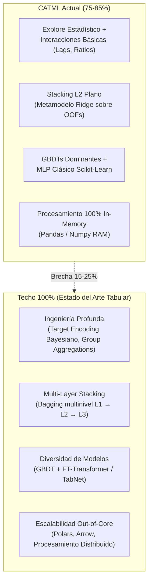

# Análisis Crítico: Techo de Rendimiento de CATML en Datos Tabulares (75-85% vs 100%)

> **Documento de reflexión técnica y debate para roadmap.**  
> **Fecha:** 2026-10-28  
> **Versión base:** `0.9.0-rc1`  
> **Propósito:** Evaluar con honestidad científica las fortalezas reales de CATML en datos tabulares, desglosar las razones por las que no alcanza el 100% de potencial competitivo frente a pipelines de Gran Maestro de Kaggle o AutoGluon, y fijar los puntos de partida para la discusión técnica.

---

## 1. Veredicto Ejecutivo

**CATML extrae entre un 75% y un 85% del rendimiento potencial de un dataset tabular.**

Es una plataforma excepcional para **producción, prototipado rápido y ciencia de datos científicamente honesta**:
- Protege matemáticamente contra el *data leakage*.
- Integra los mejores algoritmos de gradient boosting del mercado (LightGBM, XGBoost, CatBoost).
- Ofrece trazabilidad, gobernanza y reproducibilidad criptográfica (hashes de dataset, fold assignment hash, seeds congeladas, recetas).

Sin embargo, **no le saca el 100% al dato tabular**. La brecha del 15-25% restante no se debe a ajustes de hiperparámetros convencionales, sino a cuatro limitaciones estructurales profundas:
1. Ausencia de ingeniería de características automática profunda (*Deep Feature Synthesis*).
2. Ensamblado limitado a Stacking L2 plano en lugar de *Multi-Layer Stacking con K-Fold Bagging*.
3. Carencia de arquitecturas neuronales modernas para tablas (TabNet, FT-Transformer, TabPFN).
4. Dependencia estricta de memoria RAM en un solo nodo (pandas/scikit-learn sin soporte out-of-core).

---

## 2. Dónde CATML Sí Está en el Percentil Alto (El 80% Fuerte)

Antes de detallar los techos, estas son las ventajas competitivas consolidadas en el motor tabular de CATML:

* **Blindaje Anti-Leakage:**
  - Separación rigurosa de particiones con `StratifiedGroupKFold` y validación de solapamiento nulo entre grupos de entrenamiento y validación.
  - Validación de holdout completamente estricta (rechazo de duplicados por hash SHA-256 y hashing de filas).
  - Regla rectora de diseño: **«Propose ≠ Accept»**. Las transformaciones estadísticas y las propuestas de los agentes nunca se fusionan con el pipeline de producción sin antes ganar una verificación empírica de métrica en Cross-Validation.
* **La Trinidad GBDT:**
  - Adaptadores nativos para **LightGBM**, **XGBoost** y **CatBoost**, complementados con modelos lineales y de árboles de scikit-learn.
* **Out-Of-Fold (OOF) Blending & Stacking L2:**
  - Ensambles multimodelo con optimización de pesos Simplex (Nelder-Mead), Rank-Averaging para calibración de rankings y meta-modelo Ridge/Logistic para Stacking nivel 2.
* **Experiment Recipes (ADR-009):**
  - Transformaciones *fit-in-fold* que garantizan que el preprocesamiento con estado (imputación, scaling, codificación) aprenda exclusivamente de cada partición de entrenamiento sin tocar los datos de validación.

---

## 3. Las 4 Barreras para Alcanzar el 100% (Cuellos de Botella Reales)

### Barrera 1: Ingeniería de Atributos Automática Profunda (*Feature Synthesis*)
En problemas tabulares, **la calidad de los atributos supera al ajuste fino de modelos el 100% de las veces**.
* **Estado en CATML:** [`InteractionFeatureGenerator`](file:///home/fenic/workspace/ai-ml/CATML/src/automl/engine/features/generation/interaction_generator.py) y [`TemporalGenerator`](file:///home/fenic/workspace/ai-ml/CATML/src/automl/engine/features/generation/temporal_generator.py) generan diferencias ($A - B$), ratios ($A / B$), transformaciones monótonas y retardos (lags/rolling trends).
* **Lo que falta para el 100%:**
  - **Agregaciones por grupo multivariables (*Groupby Features*):** Calcular estadísticas acumuladas (`mean`, `std`, `min`, `max`, `count`, `skew`) agrupando por entidades categóricas o temporales (p. ej. *gasto medio por cliente en los últimos 30 días dividido por su gasto histórico*).
  - **Target Encoding Bayesiano Robusto Out-Of-Fold:** Codificación de variables de altísima cardinalidad (códigos postales, IDs de comercio) con regularización bayesiana en pliegues cruzados para evitar fugas.
  - **Embeddings de entidades:** Representación vectorial de entidades combinadas basada en co-ocurrencia o matrices de factorización.

### Barrera 2: Stacking Multinivel y Bagging Recursivo (vs. AutoGluon)
* **Estado en CATML:** Implementa Stacking de Nivel 2. Los modelos base entrenan pliegues cruzados, generan matrices OOF, y un único metamodelo (Ridge o regresión logística) aprende a ponderar las predicciones.
* **Lo que falta para el 100%:**
  - AutoGluon y los ganadores de competiciones usan **Multi-Layer Stacking con K-Fold Bagging repetido**:
    - **Capa 1:** 15 a 20 modelos base (LightGBM con 3 semillas, CatBoost con 2 variantes, XGBoost, etc.).
    - **Capa 2:** Las matrices OOF de la Capa 1 se concatenan directamente a los datos originales de entrada, formando una matriz enriquecida. Sobre ella se entrenan otros 10 modelos que aprenden relaciones no lineales entre las predicciones base.
    - **Capa 3:** Meta-ensamble final.
  - Este diseño exprime entre 1 y 3 puntos adicionales de ROC-AUC / F1 / RMSE en datasets difíciles, a costa de una demanda computacional exponencial.

### Barrera 3: Ausencia de Deep Learning Tabular Moderno
* **Estado en CATML:** El soporte de redes neuronales está limitado a `MLPClassifier` y `MLPRegressor` de scikit-learn (perceptrón multicapa estándar con capas densas y backpropagation básica).
* **Lo que falta para el 100%:**
  - Los modelos basados en árboles (GBDT) superan a las redes neuronales en el 90% de problemas tabulares individuales. Sin embargo, en un ensamble de alto rendimiento, **la combinación de un GBDT con una red neuronal tabular genera una reducción de varianza masiva** debido a que sus errores son matemáticamente ortogonales.
  - Faltan arquitecturas tabulares modernas:
    - **FT-Transformer (Feature Tokenizer Transformer):** Trata las columnas numéricas y categóricas como tokens de atención.
    - **TabNet:** Selección secuencial de atributos mediante máscaras dispersas aprendibles.
    - **TabPFN:** Inferencia prior-data bayesiana ultra-rápida en datasets pequeños (<10.000 filas).

### Barrera 4: Escalabilidad Out-Of-Core y Presión de Memoria
* **Estado en CATML:** El motor asume que el conjunto de datos completo y sus copias transformadas caben holgadamente en la memoria RAM del sistema (`pandas.DataFrame` y `numpy.ndarray`).
* **Lo que falta para el 100%:**
  - En datasets reales con decenas de millones de filas o cientos de gigabytes, CATML se detiene por error de falta de memoria (`MemoryError` / OOM).
  - No cuenta con ejecución out-of-core ni lazy evaluation basada en **Polars**, **Apache Arrow** o cómputo distribuido (Ray / Dask).

---

## 4. Comparativa de Posicionamiento

| Criterio | Solución Típica Manual | CATML (`0.9.0-rc1`) | AutoGluon (Best Quality) | Kaggle Grandmaster Manual |
| :--- | :--- | :--- | :--- | :--- |
| **Tiempo de desarrollo** | Días / Semanas | **10 - 20 minutos** | 30 - 120 minutos | 2 - 4 semanas |
| **Rendimiento tabular relativo** | 50% - 65% | **75% - 85%** | 90% - 95% | **98% - 100%** |
| **Control de Data Leakage** | Bajo (fugas frecuentes) | **Matemático / Estricto** | Alto | Manual estricto |
| **Explicabilidad y Gobierno** | Nula / Artesanal | **Alta (Recetas, Hashes)** | Baja (Caja negra L3) | Media (Notebooks) |
| **Ingeniería de Atributos** | Manual guiada | Heurística estadística | Media automática | **Profunda y adaptada al negocio** |
| **Cómputo requerido** | Bajo | **Moderado (CPU local)** | Masivo (CPU/GPU) | Masivo (GPU clusters) |

---

## 5. Puntos de Debate para la Sesión de Mañana

1. **Definición de Identidad de CATML:**
   - ¿Queremos convertir CATML en un competidor de fuerza bruta (estilo AutoGluon, con stacking multinivel y alto consumo de GPU)?
   - ¿O su propuesta de valor prioritaria es ser la plataforma de AutoML **más honesta, auditable, reproducible y segura para ingeniería y producción**?
2. **Priorización de Ingeniería de Atributos:**
   - Antes de añadir más modelos, ¿deberíamos implementar un generador automático de *Groupby Aggregations* (p. ej., `mean/std/count` por entidad) y *Target Encoding Out-Of-Fold* regularizado?
3. **Evolución del Stacking:**
   - ¿Es viable introducir un *Stacking Multinivel L2+* opcional (`--preset high-performance`) sin violar la arquitectura hexagonal y la simplicidad de mantenimiento?
4. **Eficiencia en Datos:**
   - ¿Cuándo conviene dar el salto a Polars / PyArrow para evitar cuellos de botella de RAM en datasets grandes?
